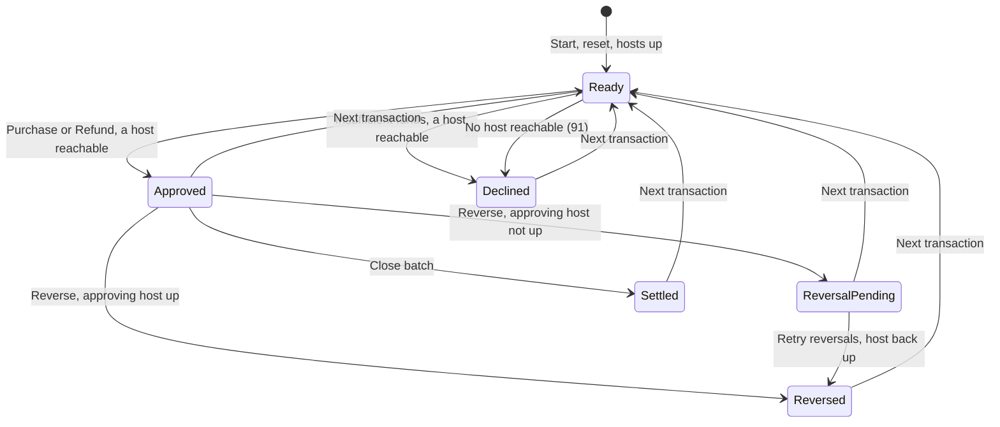

# payment-switch-mbt

[](https://github.com/dobdaniel1/payment-switch-mbt/actions/workflows/ci.yml)


Model-based tests for a card payment switch, in Java with GraphWalker.

**[Explore the model](https://dobdaniel1.github.io/payment-switch-mbt/)**: the states, the actions that move a transaction between them, and every transition in plain English.

The system under test is [payment-switch-simulator](https://github.com/dobdaniel1/payment-switch-simulator). Instead of writing test cases one by one, this repo describes how a transaction moves through the switch as a model. GraphWalker generates the test sequences from it, every step runs against the real switch, and after every step the whole switch is compared with what the model says it should hold.

## Why model-based

Scripted tests check the paths someone thought to write down. Defects in a payment switch tend to sit in orderings nobody wrote down: a reversal queued while the issuer is down, then a batch close, then the issuer coming back. A model states the rules once, and the generator then exercises them in thousands of orderings, including ones no tester would choose.

## The model

[`TransactionLifecycle.json`](src/test/resources/io/github/dobdaniel1/mbt/TransactionLifecycle.json): 6 states, 45 transitions, 15 actions. It follows one Visa transaction at a time (routed to host-a, failing over to host-c), while every earlier transaction stays on the switch and is checked too.



Not drawn, to keep the picture readable, are the transitions that stay in the same state:

| Action | Available in | What must happen |
|---|---|---|
| Resend the same terminal and STAN | every state but Ready | the original transaction comes back with `duplicate: true`, never a second charge |
| Reverse again | Declined, Reversed, ReversalPending, Settled | repeats are idempotent; declined and settled transactions are refused with 409 |
| Close batch | every state | settles approved, unsettled transactions only; 409 when there is nothing to settle |
| Retry reversals | Ready, ReversalPending | queued reversals reach hosts that are back up and stay queued for the rest |
| Set host-a up, down or timeout; host-c up or down | Ready, Approved, ReversalPending | routing, failover and reversal delivery follow the new status |

Guards on the transitions use three model variables: `hostA`, `hostC` and `approvedBy`. For example, a reversal leads to Reversed only when the host that approved the transaction is up, otherwise to ReversalPending.

## The oracle

[`ExpectedSwitch`](src/test/java/io/github/dobdaniel1/mbt/ExpectedSwitch.java) predicts the switch's state for every transaction, not only the one being followed:

- **Routing:** host-a first, then host-c. Each attempt is predicted (`unavailable`, `timeout`, or the response code), as well as the answering host and the final code, 91 when neither host is reachable.
- **Reversals:** delivered when the approving host is up, queued otherwise. Repeats change nothing. Declined and settled transactions cannot be reversed.
- **Store and forward:** a retry delivers exactly the queued reversals whose host is up.
- **Settlement:** only approved, unsettled transactions, with purchase, refund and net totals that must match to the minor unit.

Each step is checked twice. Edges (actions) check the API response. Vertices (states) check that the model and the oracle agree, then fetch every transaction and both hosts from the switch and compare them all with the oracle.

## Runs

| Test | Generator | Typical run |
|---|---|---|
| `everyTransitionAtLeastOnce` | `random(edge_coverage(100))` | 200 to 2,500 actions until all 45 transitions are taken |
| `longRandomWalk` | `random(length(2000))` | about 1,000 actions and 120 to 130 transactions |

CI walks 2,000 steps on every push and 20,000 every night. GraphWalker's coverage report for each run is uploaded as an artifact.

## Does it catch defects?

A suite that passes proves little until it has been seen to fail. Three realistic defects were planted in a copy of the switch, one at a time, and the edge coverage walk was run with seeds 1, 2 and 3:

| Planted defect | Caught | Last steps before the failure (seed 1) |
|---|---|---|
| Batch also settles transactions whose reversal is still queued | 3 of 3 seeds | reversal queued, host-c down, retry, close batch: 2 settled instead of 1 |
| A host that is timing out counts as having received the reversal | 3 of 3 seeds | purchase on host-a, host-a times out, reverse: REVERSED instead of REVERSAL_PENDING |
| A settled transaction can still be reversed | 3 of 3 seeds | close batch, reverse: 200 instead of 409 |

The unmodified switch passes.

## Replaying a failure

Every run prints its seed, and a failure prints the last 25 actions with expected and actual values:

```
everyTransitionAtLeastOnce: seed=7 actions=1207 transactions=156 edges 45/45 (100%) vertices 6/6
```

The same seed walks exactly the same path:

```bash
mvn test -Dmbt.seed=7
```

## Run locally

GraphWalker 4.3.3 evaluates guards with GraalVM JavaScript 22.3, which runs on Java 17 to 21. The build stops with a clear message on newer JDKs.

Start the switch:

```bash
git clone https://github.com/dobdaniel1/payment-switch-simulator
cd payment-switch-simulator && docker compose up -d --build --wait
```

Walk the model:

```bash
mvn test                                  # both walks
mvn test -Dmbt.walkLength=20000           # a longer random walk
mvn test -Dmbt.seed=7                     # replay a seed
mvn test -Dswitch.url=http://other-host:8000
```

Each run resets the switch's data first.

## Project layout

```
src/test/resources/.../TransactionLifecycle.json   the model: states, transitions, guards
src/test/java/.../
  TransactionLifecycleModel   runs each step against the switch and checks the result
  ExpectedSwitch              the oracle
  SwitchClient                HTTP adapter for the switch API
  TransactionLifecycleTest    JUnit entry: generators, seeds, coverage report
  ModelPage, ModelPageTest    builds and checks the model page
site/
  index.template.html         the model page
  model-text.json             plain-English wording for every part of the model
```

The [model page](https://dobdaniel1.github.io/payment-switch-mbt/) is built from the same model file by [`ModelPage`](src/test/java/io/github/dobdaniel1/mbt/ModelPage.java), with the plain-English wording kept in [`site/model-text.json`](site/model-text.json). The build fails if any state, action or condition has no wording, and CI republishes the page on every push to main once the model tests pass.

The GraphWalker Maven plugin generates a Java interface from the model on every build, so adding or renaming a step in the model fails compilation until the step is implemented.

## Scope

The model covers the Visa route (host-a with host-c as fallback), purchases, refunds, declines, duplicates, reversals, store and forward, failover and settlement within one business day. Other routes, expired and invalid cards, and reconciliation are covered by the scripted suites in [qa-automation-framework](https://github.com/dobdaniel1/qa-automation-framework).

## License

MIT
